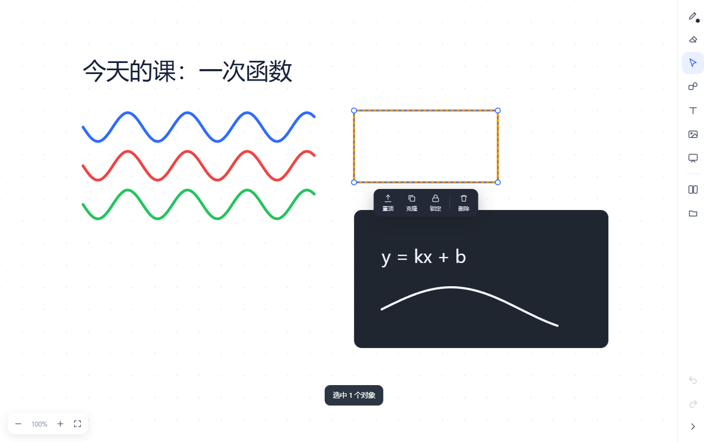

# 简黑板 · Clean Blackboard

[](https://www.python.org)
[](LICENSE)
[](#)

**简黑板（Clean Blackboard）** 是一个双击就能写的桌面白板：不用注册、不用登录、不联网，文件留在自己硬盘上。



<sub>右边那条 56 px 的细条就是全部工具栏；框选之后浮出的工具条可以置顶、锁定、改字号颜色。</sub>

## 为什么又做一个白板

市面上的白板要么绑账号绑云端，要么打开先弹一个登录框；好不容易进去，写两笔就卡成幻灯片。

这个白板的目标很朴素：**点开 <kbd>简黑板.exe</kbd>，0.5 秒后就能写字。** 没有启动页、没有账号、没有云同步。文件留在你自己的硬盘上。

## 上手

| 想做的事 | 怎么做 |
| --- | --- |
| 写字 | 直接按住鼠标拖；按 <kbd>P</kbd> 切回画笔 |
| 换颜色、粗细、笔型 | **再点一次画笔图标**，弹出小窗（笔 / 荧光笔 / 书法笔） |
| 框选一批东西 | 按 <kbd>V</kbd>，在空白处拖出选框 |
| 改选中的东西 | 选中后浮出工具条：置顶 / 克隆 / 锁定 / 字号 / 颜色 / 删除 |
| 移动位置 | 拖它本身；右上角小方块可以缩放 |
| 加图片 | 直接把图片**拖进窗口**，或 <kbd>Ctrl</kbd>+<kbd>V</kbd> 粘贴 |
| 插一块小黑板 | 点侧边栏的小黑板图标，在上面写字自动变白 |
| 存下来 | <kbd>Ctrl</kbd>+<kbd>S</kbd> 存工程（`.wbjson`），<kbd>Ctrl</kbd>+<kbd>E</kbd> 导出 PNG |
| 打开 | <kbd>Ctrl</kbd>+<kbd>O</kbd>，或把 `.wbjson` **拖到 exe 图标上** |

侧边栏是右边一条 56 px 的细条，按 <kbd>Tab</kbd> 收起，给画布让出整块地方。

## 快捷键

| 键 | 作用 |
| --- | --- |
| <kbd>P</kbd> / <kbd>E</kbd> / <kbd>V</kbd> / <kbd>T</kbd> | 画笔 / 橡皮 / 选择 / 文字 |
| <kbd>1</kbd>~<kbd>4</kbd> | 粗细 |
| <kbd>Ctrl</kbd>+<kbd>Z</kbd> / <kbd>Ctrl</kbd>+<kbd>Shift</kbd>+<kbd>Z</kbd> | 撤销 / 重做 |
| <kbd>Ctrl</kbd>+<kbd>D</kbd> | 克隆选中 |
| <kbd>Delete</kbd> | 删除选中 |
| <kbd>Ctrl</kbd>+<kbd>滚轮</kbd> | 缩放画布 |
| <kbd>空格</kbd>+拖 | 平移画布 |
| <kbd>Tab</kbd> | 收起 / 展开侧边栏 |

## 关于「未响应」

这个坑踩了三次，根因很隐蔽，记在这里免得再犯。

**症状**：双击打开，界面正常画出来，也能看出是白板——但点哪儿都没反应，标题栏过几秒变成「简黑板 1.0.0 (未响应)」。

**根因**：pywebview 启动时要先把 `js_api` 对象「翻译」成 JS 接口，做法是递归遍历它的**所有公开成员**（`webview/util.py` 的 `get_functions`，没有环检测）。我为了在回调里弹文件对话框，把窗口对象存成了 `api.window`——于是这个遍历顺着 Window 走进了 pythonnet 的整个 .NET 对象图，永远走不完。主线程卡在 `create_window()` 里，窗口自然一直不响应。

而页面本身跑在 WebView2 的渲染进程里，是另一个进程，所以**画面照样画出来**——这就是为什么「看起来是好的，一用就死」。

**修法**：
1. 窗口引用改成私有 `api._window`（下划线开头会被跳过）；
2. 给 `Api` 加 `__dir__`，只返回公开**方法**，属性一个都不暴露——双保险；
3. 自检脚本 `build_tools/apitest.py` 把这条约束固化成断言，`smoke.py` 则把「假死」的判定阈值改成等 7 秒（Windows 要 5 秒才打标记，早测会漏）。

顺带修掉的另一个真 bug：`create_file_dialog` 的 `file_types` 必须是「字符串元组」，我原来传了 `[("说明", "*.ext")]` 这种列表套元组，**每次保存/打开都直接抛 `TypeError`**——也就是说之前根本存不了文件。

渲染层面的优化（仍然是现在的实现）：

1. **每帧重画全部内容** → 已完成内容画进离屏缓存，每帧只 `drawImage` 贴一次；
2. **每个点单独 `stroke()`** → 按笔宽分组建路径，一笔一次画完；
3. **每个 pointermove 都直接重绘** → `requestAnimationFrame` 合并，一帧最多画一次。

实测（1440×900，Edge 内核）：600 点长笔画 **6~9 ms** 画完，空闲帧率 **240 fps**。

## 卡了怎么查

程序里有两条自带的记录：

- `%APPDATA%\CleanBlackboard\diag.log` —— 渲染超过 800ms 会自动写一行，带对象数、画布尺寸、屏幕分辨率
- `%APPDATA%\CleanBlackboard\crash.log` —— 启动失败的完整堆栈

想看得更细，在地址后面加 `?diag=1`（或在控制台执行 `localStorage.setItem('whiteboard.diag','1')` 后重开），
每一次点击、重绘、提交都会记进 `diag.log`。

`build_tools/liveprobe.py` 会在**真实的 WebView2 内核**里跑一遍开机和点击，直接打印面板状态和主线程心跳——
这套东西就是为了不再靠"感觉卡不卡"来判断。

## 数据在哪

全部在本地：

- `%APPDATA%\CleanBlackboard\webview\` —— 自动保存的草稿（关掉再开还在）
- 你自己存的 `.wbjson` —— 就是 JSON，可以用文本编辑器打开，也可以写脚本批量生成

不联网、不上传、不需要账号。删掉这个目录就等于清空所有痕迹。

## 从源码跑

```bash
pip install pywebview pillow
python main.py
```

需要 Windows 10/11 自带的 WebView2 运行时（一般都有；没有的话去微软官网装一个）。

## 打包成 exe

```bash
pip install pyinstaller
python build_tools/build.py
# 产物：dist/简黑板.exe（单文件，约 14 MB）
```

打包完建议跑一遍两个自检：

```bash
python build_tools/apitest.py               # 接口形状（防「启动即假死」复发）+ 存读往返
python build_tools/smoke.py dist/简黑板.exe   # 能否开、7 秒后会不会假死、界面画出来没有
node   build_tools/uitest.js                # 画笔/框选/工具条/小黑板/存档/导出 PNG
```

`uitest.js` 用真实 Edge 内核跑 31 项断言，exe 里装的就是同一份 `index.html`，所以过了这套就等于过了桌面版。

## 工程结构

```
clean-blackboard/
├─ main.py                原生外壳：窗口、DPI、文件对话框、崩溃日志
├─ ui/index.html          整个界面（HTML + CSS + Canvas，单文件）
├─ assets/                图标
└─ build_tools/
   ├─ build.py            PyInstaller 打包
   ├─ apitest.py          接口自检（18 项，含「启动即假死」的回归）
   ├─ smoke.py            启动自检（等 7 秒再看是否假死、是否白屏）
   ├─ uitest.js           交互自检（31 项）
   ├─ liveprobe.py        在真实 WebView2 内核里跑一遍开机和点击
   ├─ perfprobe.py        帧耗时（塞 300 笔迹再量）
   └─ checkjs.js          页面脚本语法检查
```

界面刻意做成单文件：没有构建步骤、没有 npm、没有依赖，改完存盘刷新就见效。

## 已知边界

- 只支持 Windows（WebView2 + PyInstaller 打包）
- 手写压感：支持 Windows Ink 笔（Surface / 数位板），鼠标只有固定粗细
- 对象数量上到几千个时拖动会开始变慢（离屏缓存失效，需要全量重画）
- 没有多人协作、没有云同步，这不是遗漏，是取舍

## 许可

MIT License，详见 [LICENSE](LICENSE)。

---

<sub>English: A desktop whiteboard for Windows that opens straight into a canvas — no account, no sign-in, no network. Built with pywebview (WebView2) and a single-file HTML/CSS/Canvas UI, packaged as a 14 MB single executable. Supports pen/highlighter/brush, free marquee selection with a floating toolbar (bring to front, lock, font size, color, delete), drag-and-drop images, an embedded mini blackboard, multi-page, undo/redo, `.wbjson` project files and PNG export. Rendering uses an offscreen cache layer plus stroke-path batching, which keeps long strokes at ~7 ms per frame.</sub>
